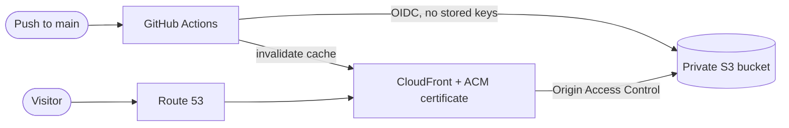

# hammondmutambara.com

The source for my portfolio site and all the AWS infrastructure behind it. Nothing is created by hand in the AWS console: the site, the CDN, DNS, certificate and CI/CD access are all Terraform, and every change goes through Git.

## How it works



| Piece | What it does |
|---|---|
| S3 (private) | Holds the site files. Public access is blocked, and only this CloudFront distribution can read the bucket. Versioning is on, so a bad deploy can be rolled back. |
| CloudFront | Serves the site over HTTPS from edge locations, with caching and security headers. |
| ACM | Free TLS certificate for the root domain and `www`, validated by DNS and renewed automatically. |
| Route 53 | A and AAAA alias records for the root domain and `www`. |
| GitHub OIDC | Lets Actions sign in to AWS with short-lived credentials, so no AWS keys are stored in GitHub. |
| Terraform | Defines all of the above. State is kept in a versioned, encrypted S3 bucket. |

More detail is in [docs/ARCHITECTURE.md](docs/ARCHITECTURE.md).

## Repository layout

```
.
├── site/                    # The website. Edit this to change what visitors see.
│   └── index.html
├── terraform/               # Infrastructure for the site (main stack)
├── bootstrap/               # One-off: creates the bucket that stores Terraform state
├── scripts/
│   ├── discover-console-resources.sh   # Read-only inventory of what exists in AWS
│   ├── set-github-vars.sh              # Copies Terraform outputs into GitHub variables
│   └── deploy-site.sh                  # Manual deploy, same steps as CI
├── docs/
│   ├── ARCHITECTURE.md
│   ├── RUNBOOK.md           # How to update the site, change infra, roll back
│   └── MIGRATION.md         # Moving console-built resources to Terraform
└── .github/workflows/
    ├── deploy-site.yml      # site/ changes on main -> S3 + cache invalidation
    └── terraform-plan.yml   # Pull requests -> terraform plan (read-only)
```

## Updating the site

1. Edit `site/index.html` (text, project links, certificates, results).
2. Preview it locally: `python3 -m http.server 8000 --directory site`, then open <http://localhost:8000>.
3. Commit and push to `main`. The **Deploy site** workflow uploads the files and clears the CloudFront cache.

The page's project and certificate links live in one `LINKS` block near the bottom of `index.html`. Paste a URL there and that button appears. Leave it empty and the button stays hidden.

Step by step instructions, including rollback, are in [docs/RUNBOOK.md](docs/RUNBOOK.md).

## Changing the infrastructure

1. Create a branch and edit files in `terraform/`.
2. Open a pull request. **Terraform plan** runs and shows what would change.
3. After review, merge, then apply from your machine:

```bash
cd terraform
terraform init -backend-config=backend.hcl
terraform plan
terraform apply
```

Applies are run locally on purpose, so the CI role stays read-only.

## First-time setup

Follow [docs/MIGRATION.md](docs/MIGRATION.md). In short: inventory what exists, run `bootstrap/`, run `terraform/`, copy the outputs into GitHub with `scripts/set-github-vars.sh`, then push.

## Requirements

- Terraform 1.10 or newer
- AWS CLI signed in to the target account
- GitHub CLI (`gh`) for `scripts/set-github-vars.sh`

## Author

Hammond Mutambara. [GitHub](https://github.com/hammond-0023) · [LinkedIn](https://linkedin.com/in/hammond-m)
