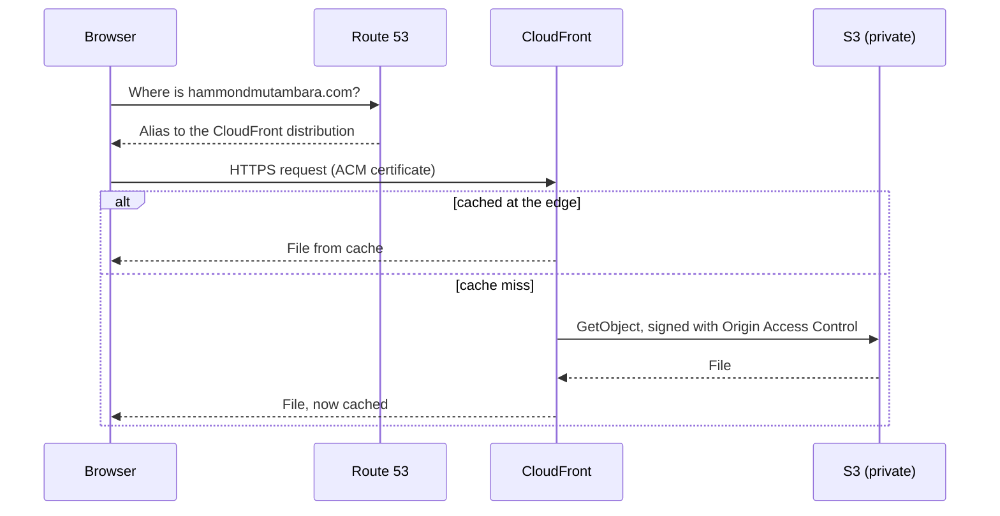
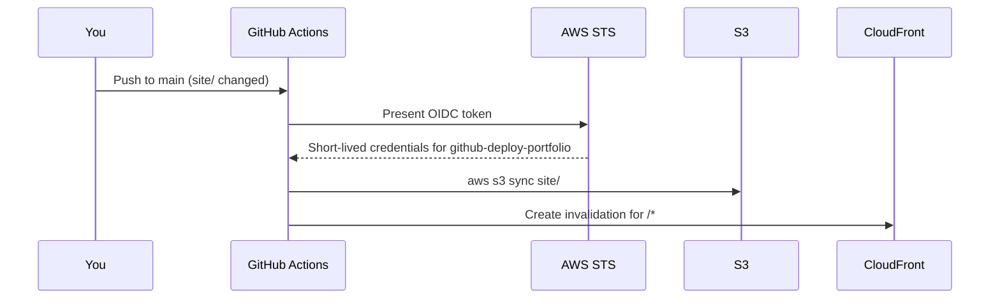

# Architecture

## Request path

## Deployment path

## Design decisions

**Private bucket with Origin Access Control.** The first version used a public bucket with a public-read ACL. The bucket is now private, and a bucket policy allows reads only from this one CloudFront distribution. Visitors cannot bypass the CDN, and there is no public ACL to misconfigure.

**OIDC instead of access keys.** GitHub Actions exchanges a signed token for short-lived credentials. There are no long-lived AWS keys in GitHub. The deploy role trusts only the `main` branch of this repository and can only write to the site bucket and create CloudFront invalidations.

**Two roles, different power.**

| Role | Trusted from | Can do |
|---|---|---|
| `github-deploy-portfolio` | `main` branch | Upload to the site bucket, create invalidations |
| `github-plan-portfolio` | pull requests and `main` | Read-only (AWS `ReadOnlyAccess`), used for `terraform plan` |

**Applies run locally.** CI only plans. Giving a pipeline permission to create IAM roles and CloudFront distributions means a compromised workflow could take over the account, so applies are a deliberate step from your own machine. If you later want CI applies, add a third role with a narrow policy and a protected GitHub environment that needs approval.

**The hosted zone is looked up, not managed.** Deleting a Route 53 zone changes its nameservers and takes the domain offline until the registrar is updated. Records inside the zone (certificate validation, aliases) are managed. See [MIGRATION.md](MIGRATION.md) if you want to adopt the zone itself.

**Terraform state lives in S3.** The bucket is created by `bootstrap/` with versioning, encryption and public access blocked. Locking uses S3's native lock file (`use_lockfile`), so no DynamoDB table is needed.

**Cache behaviour.** HTML is cached for five minutes at the browser and edge, and every deploy invalidates the whole distribution. For a site this small the invalidation cost is negligible (the first 1,000 paths a month are free).

## Cost

Typical monthly cost for a low-traffic portfolio is a few cents to a couple of dollars: one Route 53 hosted zone (about $0.50), a small amount of S3 and CloudFront usage, and nothing for ACM or the GitHub OIDC provider. Check the AWS pricing pages for current figures.
